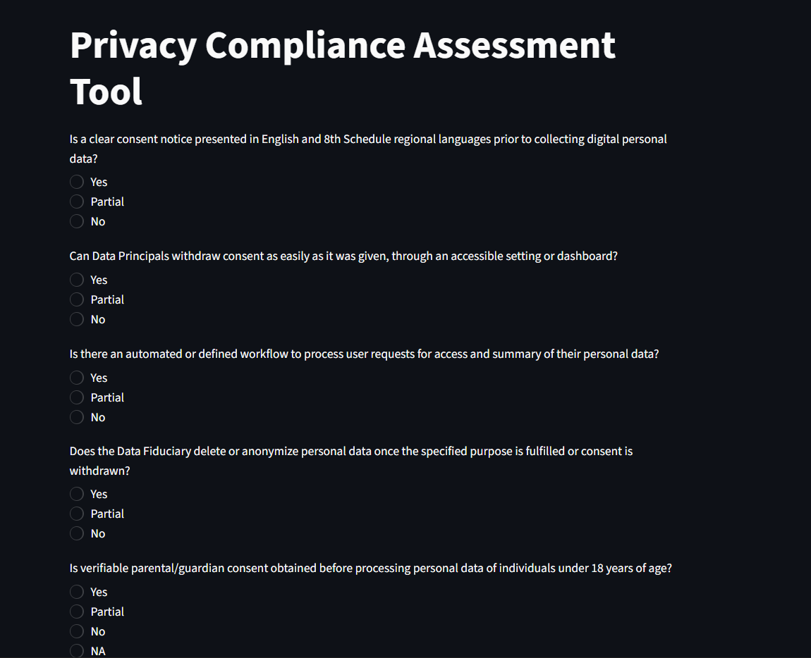
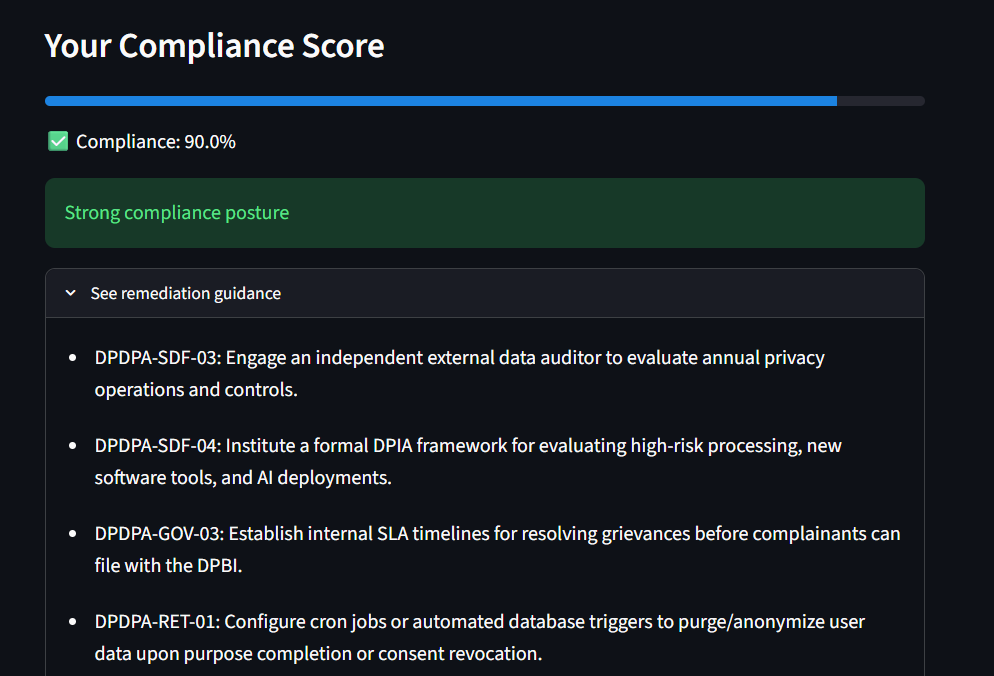

# Privacy Compliance Assessment Tool

**Live app:** [Streamlit deployment](https://privacy-compliance-projects-hyfic37uib8yu38v2ukzmk.streamlit.app/)

Part of the [Privacy Compliance Project Portfolio](../README.md). Related projects: [DPDPA & GDPR Comparative Analysis](../DPDPA%20%26%20GDPR/) and the [Sample DPDPA Data Processing Agreement](../DPA/).

> **Disclaimer:** This tool is for educational and self-assessment purposes only. Its score is a risk indicator, not a legal opinion or a certification of compliance. Consult a qualified legal professional for compliance decisions.

## Overview

A Streamlit dashboard that helps an organisation gauge its privacy compliance posture against **DPDPA and GDPR** requirements. It started as a Typeform checklist and grew into a web app, hosted from this repository on Streamlit Community Cloud.

## Features

- Interactive questionnaire with **Yes / Partial / No** answers
- **Compliance percentage** with a progress bar
- **Colour-coded risk posture:** green for strong, yellow for moderate, red for high risk
- **Remediation guidance** in expandable sections for each gap
- **Donut chart** showing how your answers are distributed
- Built with Streamlit, Pandas, OpenPyXL and Altair

## Screenshots

**1. Questionnaire**



**2. Compliance dashboard**


**3. Remediation guidance**



## How it works

1. Answer each checklist question with **Yes**, **Partial** or **No**.
2. The app converts your answers into an overall **compliance percentage**.
3. The percentage is mapped to a **risk posture**: strong, moderate or high risk.
4. Expand any gap to see **remediation guidance**.
5. Review the donut chart for a quick view of your answers.

### Scoring method

| Answer | Points |
|---|---|
| Yes | [1] |
| Partial | [0.5] |
| No | [0] |

Compliance % = points earned divided by the maximum possible points, times 100.

| Compliance % | Risk posture |
|---|---|
| [80% and above] | Strong (green) |
| [50% to 79%] | Moderate (yellow) |
| [Below 50%] | High risk (red) |

Questions are drawn from the checklist in `Compliance_Assessment_Project.xlsx`. [Optional: add a column mapping each question to the DPDPA section or GDPR article it relates to.]

## Privacy note

Answers are processed in your browser session and are not saved by the app. [Confirm this against `app.py` before publishing.]

## Run locally

1. Clone the repo:

   ```bash
   git clone https://github.com/divyeshcraze-dev/privacy-compliance-projects.git
   cd "privacy-compliance-projects/Privacy Compliance Assessment"
   ```

2. (Optional) Create a virtual environment:

   ```bash
   python -m venv venv
   source venv/bin/activate      # Windows: venv\Scripts\activate
   ```

3. Install dependencies:

   ```bash
   pip install -r ../requirements.txt
   ```

4. Run the app:

   ```bash
   streamlit run app.py
   ```

5. Open `http://localhost:8501` in your browser.

## Tech stack

| Tool | Purpose |
|---|---|
| Streamlit | Web app framework and UI |
| Pandas | Scoring and data handling |
| OpenPyXL | Reading the Excel checklist |
| Altair | Donut chart |

## Project structure

```
privacy-compliance-projects/
├── requirements.txt
├── docs/                                   # Screenshots used in this README
└── Privacy Compliance Assessment/
    ├── app.py                              # Streamlit app
    ├── Compliance_Assessment_Project.xlsx  # Assessment checklist data
    └── README.md                           # This file
```

## Limitations

- The checklist mixes DPDPA and GDPR items and does not yet separate them.
- Scoring treats every question equally, so it does not reflect how serious each gap is.
- A self-assessment depends on honest answers and cannot verify what an organisation actually does.

## Roadmap

- [ ] Separate DPDPA and GDPR question sets
- [ ] Section-wise scoring (consent, data subject rights, breach response and so on)
- [ ] Export results to Excel or PDF
- [ ] Save and compare assessments over time

## Author

Divyesh S, LL.M. (Data Privacy and IT Laws), Manipal Academy of Higher Education, Bengaluru.
