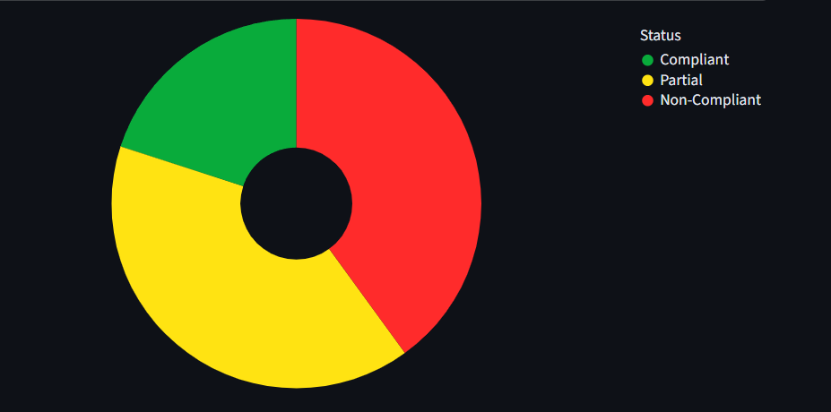

# Privacy Compliance Project Portfolio

This repository documents my monthly student projects on privacy compliance, covering India's DPDP Act, the EU's GDPR and the intersection of AI governance and data protection. Each project turns regulatory text into something operational: a research paper, a contract or a working tool.

> **Disclaimer:** These are educational projects, not legal advice. Parties, companies and data in the examples are fictional.

## Projects

| Project | Type | What it is |
|---|---|---|
| [DPDPA & GDPR Comparative Analysis](DPDPA%20%26%20GDPR/) | Research | A comparative legal assessment of India's DPDP Act and the EU GDPR, covering automated decision-making, cross-border transfers, data principal rights and penalty models. [Read the PDF](DPDPA%20%26%20GDPR/DPDPA%20%26%20GDPR%20Comparative%20Analysis.pdf) |
| [Privacy Compliance Assessment](Privacy%20Compliance%20Assessment/) | Tool | A Streamlit app that works through a compliance questionnaire, scores privacy risk and suggests remediation steps. |
| [Sample DPDPA Data Processing Agreement](DPA/) | Drafting | A sample processor agreement between a fictional e-commerce company and a storage provider, drafted to follow the DPDP Act, 2023 and the DPDP Rules, 2025, with a clause-to-law map. |

How they connect: the comparative analysis is the research, the DPA applies it in contract drafting, and the assessment app turns the requirements into a risk-scoring tool.

## Privacy Compliance Assessment



The app guides a user through a questionnaire, scores the result as a risk indicator and lists remediation steps. It is a learning tool: the score is an indicator, not a legal opinion or a certification of compliance.

More screenshots: [questionnaire](docs/screenshot-questionnaire.png) and [remediation](docs/screenshot-remediation.png).

To run it locally:

```bash
pip install -r requirements.txt
streamlit run "Privacy Compliance Assessment/app.py"
```

## Goals

- Strengthen practical skills in privacy law compliance.
- Translate regulations into operational documents.
- Build towards CIPP/E certification and privacy compliance roles.

## Future direction

- Projects at the intersection of AI and privacy.
- Comparative studies across India, the UAE and the EU (planned).

## Repository structure

```
DPA/                            Sample DPDPA data processing agreement
DPDPA & GDPR/                   Comparative analysis (PDF)
Privacy Compliance Assessment/  Streamlit app and question bank
docs/                           Screenshots
requirements.txt                Python dependencies
LICENSE                         CC0-1.0
```

## Author

Divyesh S, LL.M. (Data Privacy and IT Laws), Manipal Academy of Higher Education, Bengaluru.
